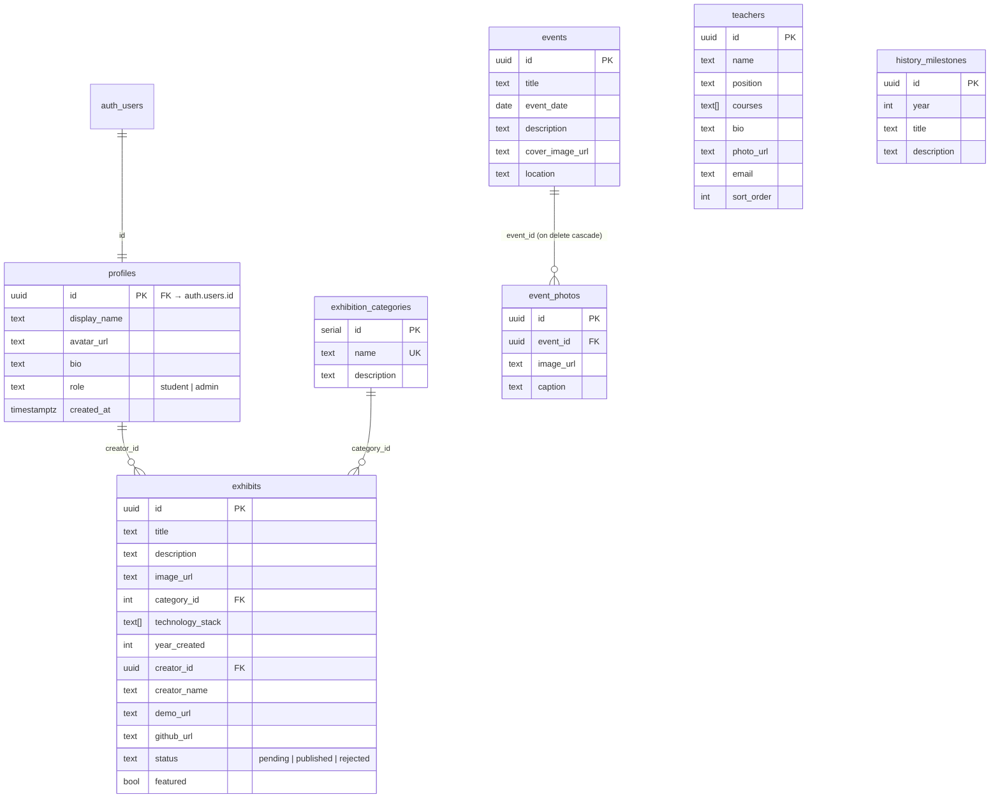

# ISM Digital Museum

Мэдээллийн Системийн Менежментийн (ISM) тэнхимийн түүх, багш нар, өдөрлөг арга хэмжээ, оюутнуудын бүтээл, технологийн хөгжлийг нэг дор хадгалж танилцуулах **интерактив дижитал музей**.

> Internet Programming · Гэрийн даалгавар №1

- **Live demo:** https://ism-digital-museum.vercel.app
- **GitHub:** https://github.com/khuln988/ism-digital-museum
- **Стек:** React 18 + Vite · React Router · Supabase (Auth, PostgreSQL, Storage, RLS) · Vercel

---

## Боломжууд

| Боломж | Хэрэгжүүлэлт |
|---|---|
| Дижитал үзэсгэлэн | `/exhibits` — үзмэрийн жагсаалт, `/exhibits/:id` — дэлгэрэнгүй (зураг, тайлбар, он, зохиогч, технологи, demo/GitHub) |
| Тэнхимийн багш нар | `/teachers` — нэр, албан тушаал, хичээл, танилцуулга, зураг; хайлт |
| Өдөрлөг, арга хэмжээ | `/events` — оноор шүүх, `/events/:id` — зурагт цомог (lightbox, ← → товч) |
| Тэнхимийн түүх | `/history` — үе шатуудын timeline |
| ISM Creators | `/creators` — оюутан бүр болон түүний бүтээлүүд |
| Хайлт ба ангилал | Нэр/тайлбар/зохиогчоор хайх (debounce), ангилал, он, технологиор шүүх, эрэмбэлэх; URL query-д хадгалагдана |
| Бүртгэл ба эрх | Бүртгүүлэх, нэвтрэх, гарах; Зочин / Бүтээгч / Админ гэсэн 3 түвшний эрх |
| CRUD + зураг | Оюутан өөрийн бүтээлийг нэмэх/засах/устгах, зургийг Supabase Storage-д байршуулна. Админ бүх агуулгыг удирдана |

### Хэрэглэгчийн төрлүүд

| Role | Эрх |
|---|---|
| **Зочин** | Нийтлэгдсэн үзмэр, багш, арга хэмжээ, түүх үзэх, хайх, шүүх, виртуал үзэсгэлэн |
| **Бүтээгч / оюутан** | + Өөрийн профайл засах, өөрийн бүтээл нэмэх/засах/устгах. Нэмсэн/зассан бүтээл `pending` төлөвт орж админ хянана |
| **Администратор** | + Бүтээл нийтлэх/татгалзах/онцлох, багш, арга хэмжээ, зургийн цомог, ангилал, түүх, хэрэглэгчийн эрх удирдах (`/admin`) |

---

## 🏛️ Бүтээлч шийдэл — Virtual Exhibition (`/virtual`)

Үзмэрүүдийг энгийн grid биш, **3D виртуал галерейн коридор** хэлбэрээр үзүүлнэ.

- **Танхимууд** — ангилал бүр нэг танхим. Таб дээр дарж танхим солино.
- **3D коридор** — CSS `perspective` + `rotateY/translateZ` ашиглан хананд өлгөсөн алтан жаазтай зургуудыг үүсгэсэн. Идэвхтэй бүтээл дээр **spotlight** тусна, шалан дээр тусгал (reflection) харагдана.
- **Алхах** — `←` `→` товч, дэлгэц дээрх сум, хажуугийн жааз дээр дарах, утсан дээр **swipe**.
- **Автомат аялал** — `Space` эсвэл ▶ товч: 7 секунд тутам дараагийн бүтээл рүү шилжинэ, progress bar-тай.
- **🎧 Аудио хөтөч** — Web Speech API ашиглан бүтээлийн нэр, зохиогч, тайлбарыг уншина; аялалтай хамт ашиглавал уншиж дуусмагц дараагийнх руу шилжинэ.
- **Музейн тэмдэглэгээ (plaque)** — №, ангилал, зохиогч, он, технологи.
- **Танхимын зураглал** — үзсэн бүтээлүүдийг тэмдэглэж «Үзсэн: 3/9» гэж харуулна.
- **Бүтэн дэлгэц**, `?focus=<id>` холбоосоор тодорхой бүтээл дээр шууд очих (дэлгэрэнгүй хуудаснаас «Үзэсгэлэнд харах»).
- Responsive (утас/таблет/компьютер), `prefers-reduced-motion` дэмжинэ.

---

## Өгөгдлийн сангийн бүтэц (ERD)



**Холбоосууд:**
- `profiles.id` → `auth.users.id` (1:1). Бүртгэл үүсэхэд `handle_new_user` trigger профайл автоматаар үүсгэнэ.
- `exhibits.creator_id` → `profiles.id` (1:N). Профайл устахад `set null`. Архивын бүтээлд `creator_name` ашиглана.
- `exhibits.category_id` → `exhibition_categories.id` (1:N) — даалгаврын `category` талбарыг нормчилж тусдаа хүснэгт болгосон.
- `event_photos.event_id` → `events.id` (1:N, `on delete cascade`).
- `history_milestones` — тэнхимийн түүхийг админ засах боломжтой болгох нэмэлт хүснэгт.

## Аюулгүй байдал (RLS)

Бүх хүснэгтэд **Row Level Security** идэвхтэй (`supabase/schema.sql`):

| Хүснэгт | SELECT | INSERT / UPDATE / DELETE |
|---|---|---|
| `exhibits` | `status='published'` **эсвэл** өөрийнх **эсвэл** админ | Зөвхөн эзэн (`creator_id = auth.uid()`) эсвэл админ |
| `profiles` | Бүгд | Зөвхөн өөрийнхөө (role-ийг өөрчлөх боломжгүй — trigger хамгаална) |
| `teachers`, `events`, `event_photos`, `exhibition_categories`, `history_milestones` | Бүгд | Зөвхөн админ (`is_admin()`) |
| `storage.objects` (bucket `media`) | Бүгд | Оюутан зөвхөн `{өөрийн user_id}/…` хавтас руу; устгах/засах — эзэн эсвэл админ |

Нэмэлт хамгаалалт:
- `exhibits_guard` trigger — админ биш хэрэглэгч `status`, `featured`-ийг өөрөө өөрчилж чадахгүй (үргэлж `pending` болно), `creator_id`-г хуурамчаар тавьж чадахгүй.
- `is_admin()` — `security definer` функц, RLS-ийн recursion-оос сэргийлнэ.
- Frontend зөвхөн **anon (public) key** ашиглана. `service_role` түлхүүр кодонд байхгүй.
- Storage: 5MB хязгаар, зөвхөн зургийн MIME төрөл.

---

## Суулгах заавар

```bash
git clone <repo-url>
cd ism-digital-museum
npm install
cp .env.example .env      # Supabase URL ба anon key-г бөглөнө
npm run dev               # http://localhost:5173
```

### Supabase тохиргоо
1. [supabase.com](https://supabase.com) дээр шинэ төсөл үүсгэнэ.
2. **SQL Editor** → `supabase/schema.sql`-ийг бүтнээр нь ажиллуулна (хүснэгт, RLS, storage bucket, жишээ өгөгдөл).
3. **Authentication → Sign In / Providers → Email** — demo-д «Confirm email»-ийг унтрааж болно.
4. **Project Settings → API**-аас `URL`, `anon public` key-г `.env`-д хуулна.
5. Сайт дээр бүртгүүлээд, өөрийгөө админ болгоно:
   ```sql
   update public.profiles set role = 'admin'
   where id = (select id from auth.users where email = 'you@example.com');
   ```

### Vercel рүү байршуулах
```bash
npx vercel --prod \
  --build-env VITE_SUPABASE_URL=... \
  --build-env VITE_SUPABASE_ANON_KEY=...
```
эсвэл GitHub repo-г Vercel-д import хийж Environment Variables-д дээрх 2 хувьсагчийг нэмнэ. `vercel.json` нь SPA routing-д зориулсан rewrite агуулна.

## Төслийн бүтэц

```
src/
  components/   Navbar, Footer, ExhibitCard, ImageInput, Lightbox, ProtectedRoute, States
  context/      AuthContext (session, profile, isAdmin)
  lib/          supabase client + uploadImage, query helpers
  pages/        Home, Exhibits, ExhibitDetail, VirtualExhibition, Teachers, Events, EventDetail,
                History, Creators, Login, Register, Dashboard, ExhibitForm, Admin, NotFound
supabase/
  schema.sql    Хүснэгт, trigger, RLS, storage policy, seed
```

## Тэмдэглэл
- Seed дэх багш, бүтээл, арга хэмжээний мэдээлэл нь **жишээ өгөгдөл** бөгөөд админ самбараас засна. Жишээ зургууд picsum.photos-оос.
- Аудио хөтөч нь браузерийн Web Speech API-д тулгуурлана; монгол дуу хоолой суугаагүй бол өөр хэлний хоолойгоор уншина.
